<div align="center">

# VryGraphic

**A personal finance tracker that reads like a terminal.**
Every entry becomes a daily balance, a salary breakdown, budget alerts and goal forecasts, all computed in PostgreSQL.

[](https://github.com/VryDeveloper/VryGraphic/actions/workflows/ci.yml)


[🇧🇷 Leia em português](README.pt-BR.md) · [Features](#features) · [Architecture](#architecture) · [Engineering decisions](#engineering-decisions) · [Run it locally](#run-it-locally)

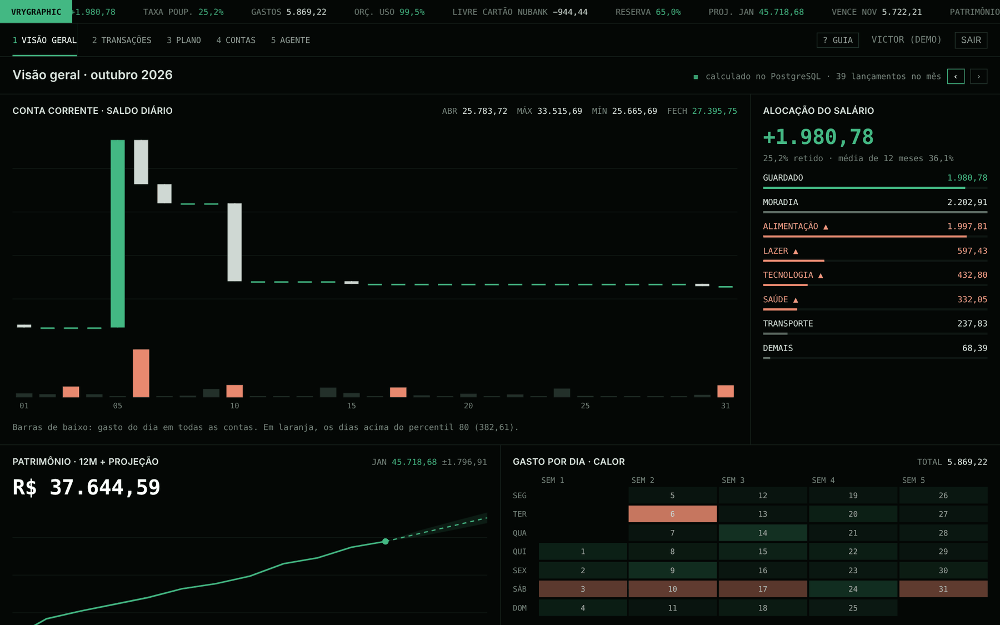

</div>

> The interface is in Brazilian Portuguese and money is in BRL. The demo account comes with 12 months of realistic, generated data.

## At a glance

| What a reviewer usually looks for | Where it is in this repo |
|---|---|
| **Real CRUD** with validation, ownership checks and soft delete + undo | `apps/api/src/modules/*` (accounts, categories, transactions, transfers, budgets, goals, recurring bills) |
| **SQL beyond `SELECT *`**: window functions, `LAG`, `RANK`, `PERCENTILE_CONT`, `FILTER`, `generate_series` | [`dashboard/queries.ts`](apps/api/src/modules/dashboard/queries.ts) |
| **Auth done properly**: JWT access token + rotating refresh token, httpOnly cookie, reuse detection | [`auth/service.ts`](apps/api/src/modules/auth/service.ts) |
| **Money handled correctly**: integer cents end to end, installments that add up to the cent | [`packages/shared`](packages/shared/src) |
| **Background jobs** that are idempotent and safe to run twice at the same time | [`jobs/`](apps/api/src/jobs) |
| **Tests against a real database**, not mocks | [`apps/api/test/integration`](apps/api/test/integration) · 124 tests |
| **AI integration with guardrails**: tool calling, human approval before any write | [`agent/`](apps/api/src/modules/agent) |
| **Product thinking**: onboarding tour, empty states, mobile layouts, reduced-motion support | [`apps/web/src`](apps/web/src) |
| **Shipping**: Docker image, CI with Postgres, one-click Render blueprint | [`Dockerfile`](Dockerfile) · [`ci.yml`](.github/workflows/ci.yml) · [`DEPLOY.md`](DEPLOY.md) |

## Features

### Command bar: type it the way you'd say it

`mercado 120,50 alimentação` → expense, R$ 120.50, Groceries, today.
`notebook 2.400 tecnologia 10x` → 10 installments on the credit card, each on the right invoice.
`+freela 640,50 trabalho inter` → income into the account aliased "inter".

The **same parser** runs in the browser (live preview while you type) and on the server (source of truth), so they can never disagree.

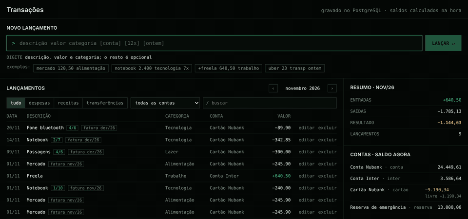

### Overview: dashboards computed in SQL

- **Daily balance as candlesticks**, with daily spending as volume bars (top 20% days highlighted using `PERCENTILE_CONT`).
- **Salary allocation**: what was saved and where the rest went, with over-budget categories flagged.
- **Net worth for 12 months + forecast** with a ±1 standard deviation band.
- **Spending heatmap** by weekday, **latest entries with the running balance** of each account (`SUM() OVER (PARTITION BY account)`), **upcoming bills** and **alerts**.
- In the first days of a month the balance chart switches to a rolling 30-day window, so it never looks empty.

<details>
<summary>Full overview screenshot</summary>

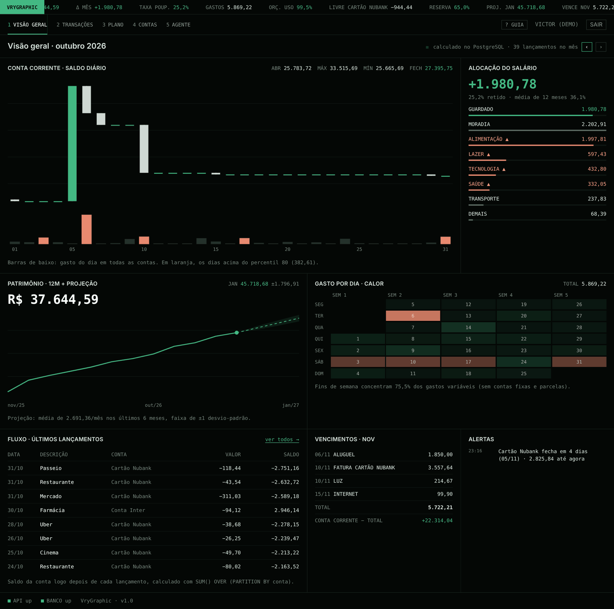
</details>

### Transactions: the CRUD

Month navigation, filters, search, inline editing (Enter saves, Esc cancels), delete with **undo**, transfers between accounts, and keyset pagination that stays stable while new entries come in.

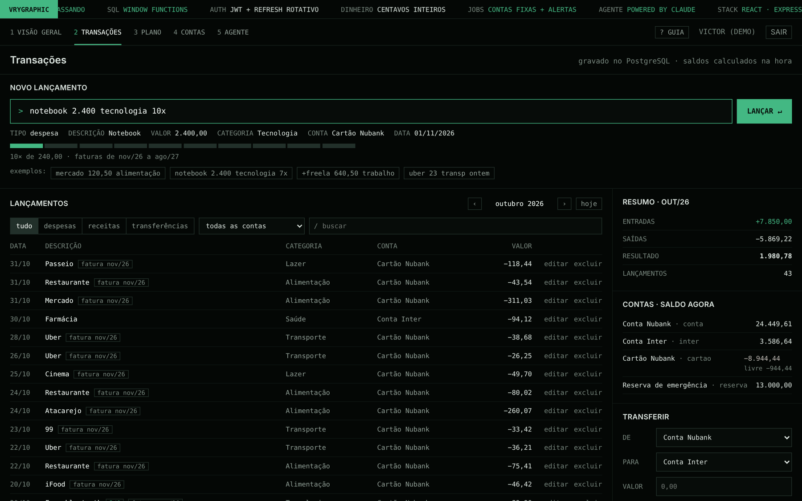

### Plan: budgets and goals

Budget vs. actual per category, a suggested limit for next month (3-month average rounded up to R$ 50, applied in one transaction), and a **goal simulator**: move the sliders and see when you hit the target with compound interest. Alert rules are configurable per user.

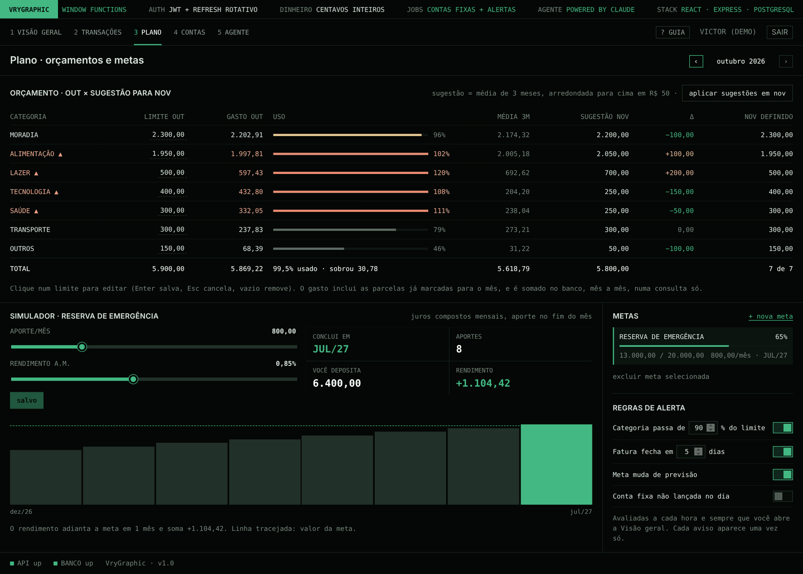

### Accounts, categories and recurring bills

Checking, savings, credit cards (limit, closing and due day), cash. Aliases feed the command bar. Recurring bills (rent, subscriptions, salary) are posted automatically on their day by a background job, which also catches up if the server was down.

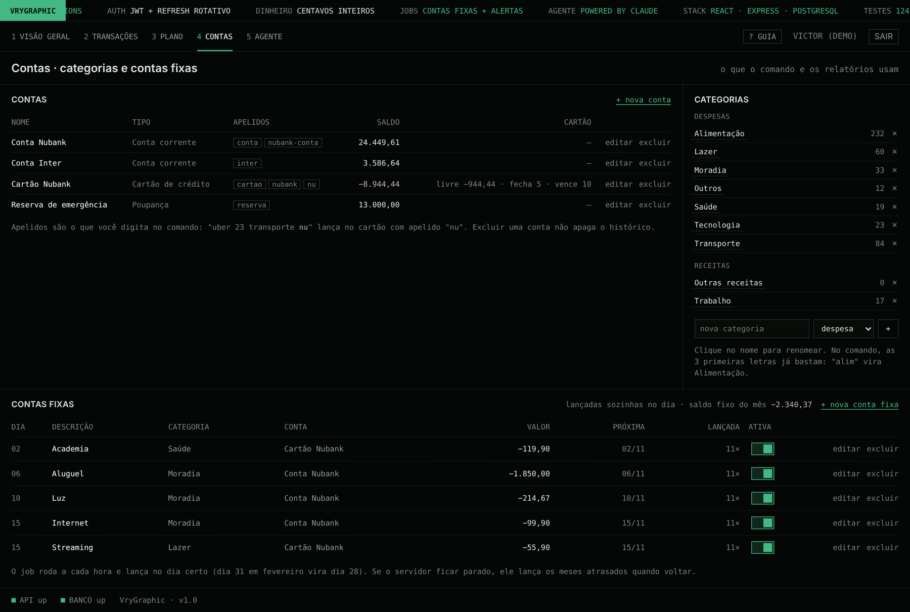

### Vry Agent: an AI assistant that asks before it writes

Ask about your money or tell it what to do. It runs on the Claude API with **11 purpose-built tools** that reuse the same services as the REST API, always scoped to the logged-in user. Read tools run on their own; **every write pauses for a `[s/n]` (yes/no) confirmation** with a preview of exactly what will be saved. No file, shell or network access.

| Asking | Confirming a write |
|---|---|
| 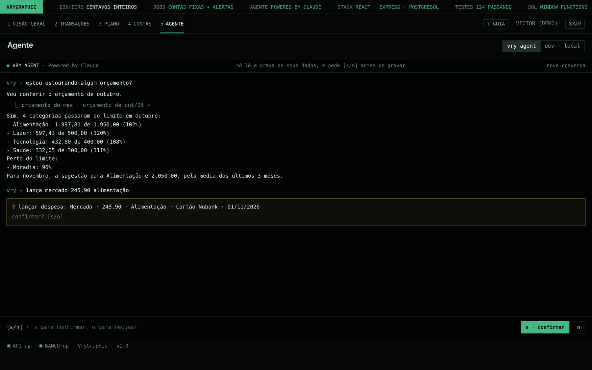 | 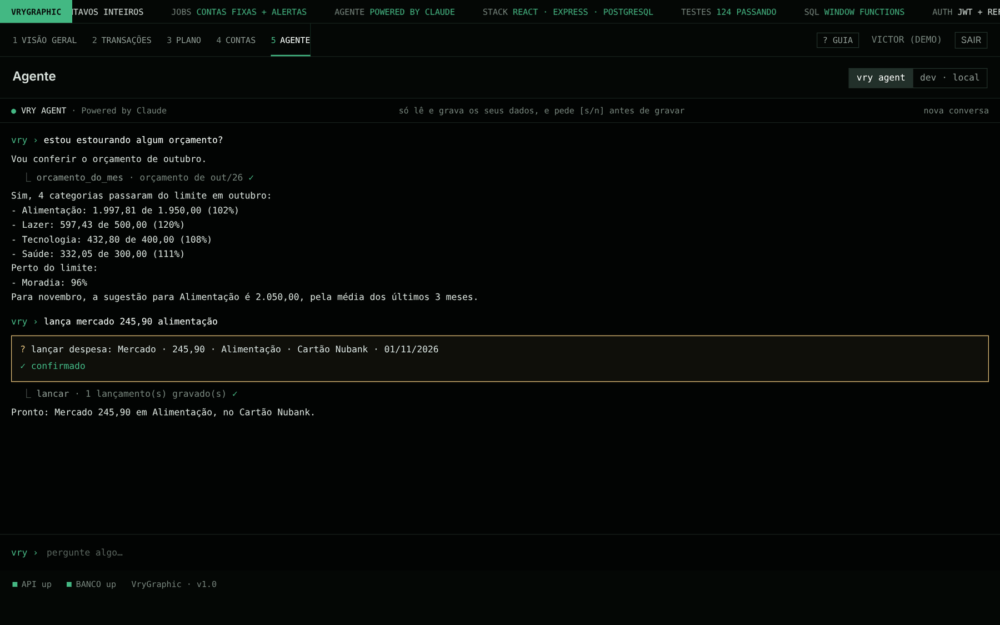 |

### Dev mode: a real terminal inside the app

When running locally, a real PTY terminal (WebSocket + `node-pty` + xterm.js) opens in the project folder to run Claude Code or any command. Locked down: off by default, never in production, loopback only, origin-checked and authenticated.

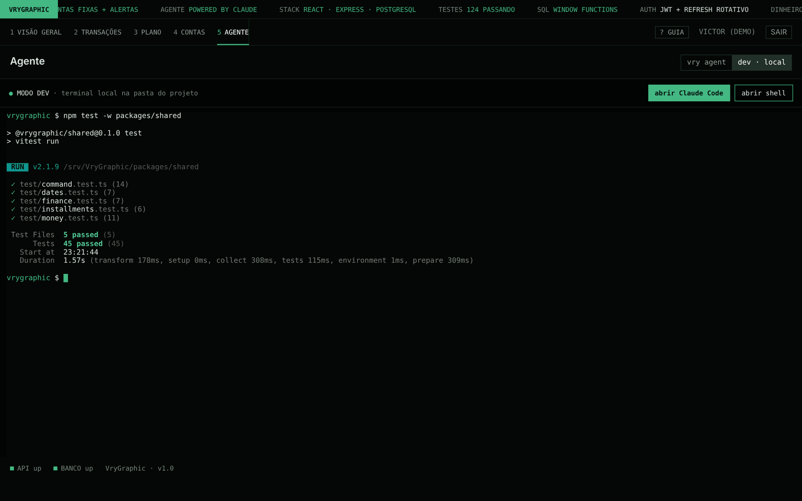

### Onboarding tour and mobile

A 23-step guided tour highlights the real UI on first use (skippable, replayable). Every screen works on a phone.

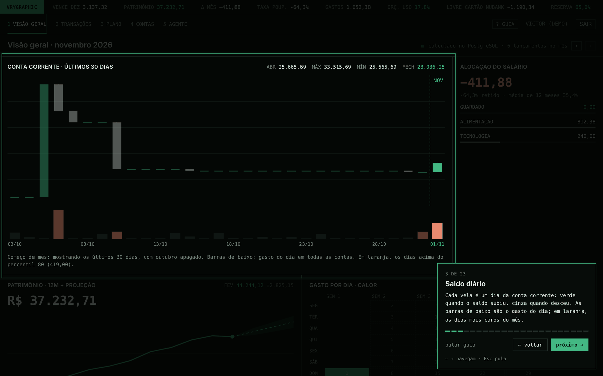

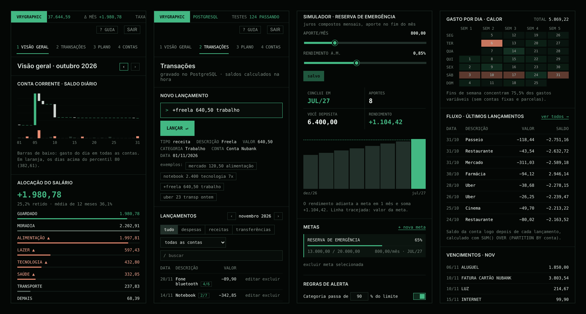

## Architecture

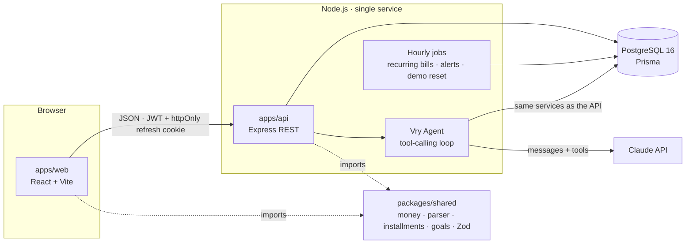

In production it is **one container**: Express serves the built React app, migrations run on boot, and the hourly scheduler runs in-process.

<details>
<summary>Data model</summary>

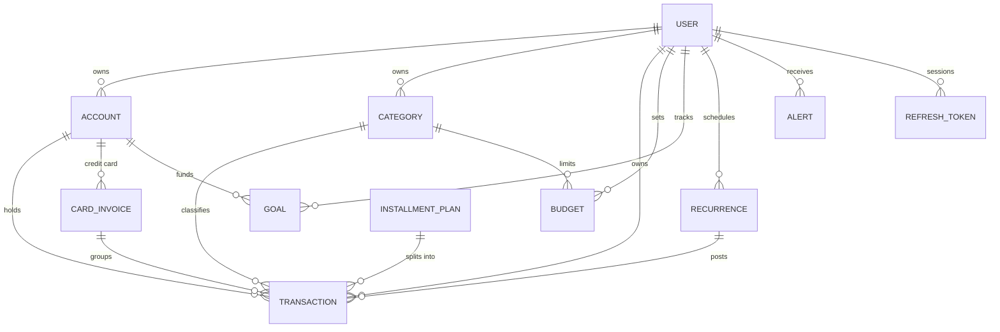
</details>

## Engineering decisions

- **Integer cents everywhere.** `BIGINT` in the database, integers in TypeScript, formatting only at the edge. Installments put the remainder on the first one (R$ 2,400.00 in 7x = 342.90 + 6 × 342.85), so totals always match to the cent.
- **Balances are never stored.** Balance = opening balance + `SUM(amount)`. No drift, no sync bugs. `CHECK` constraints make the database itself reject an expense with a positive amount, even if someone bypasses the API.
- **Heavy math in SQL, not in JavaScript loops.** One request returns every panel, built with window functions:

  ```sql
  -- running daily balance: opening balance + everything before the month + cumulative sum of the month
  SELECT d.day,
         (base.b + SUM(COALESCE(m.net, 0)) OVER w)::bigint AS close
  FROM days d CROSS JOIN base LEFT JOIN moves m ON m.day = d.day
  WINDOW w AS (ORDER BY d.day ROWS UNBOUNDED PRECEDING);
  ```

- **Time zones on purpose.** The database stores instants (`timestamptz`); every day/month grouping converts with `AT TIME ZONE 'America/Sao_Paulo'`. A date typed by the user is stored at noon local time, so it never shifts a day.
- **Keyset pagination** on `(occurred_at, created_at, id)` instead of `OFFSET`, so pages don't skip or repeat while new entries arrive.
- **Refresh tokens**: stored only as SHA-256 hashes, rotated on every use with an **atomic** `UPDATE … WHERE revoked_at IS NULL`. Reusing an old token revokes the whole token family (theft detection); reuse within 30 s is treated as two tabs racing, not as an attack.
- **Idempotent jobs.** Each recurring bill "claims" its month with a conditional `UPDATE` before posting, so two concurrent runs can't double-post; alerts use a unique `dedupe_key` + `ON CONFLICT DO NOTHING`.
- **One parser, two runtimes.** The command grammar lives in `packages/shared` and is unit tested once; the web uses it for the live preview, the API for the real insert.
- **AI with a human in the loop.** The agent can only call whitelisted tools, inputs are validated with Zod, wrong inputs go back to the model to fix, writes need explicit approval, and there is a per-user and per-day message cap to protect the API bill.

### Bugs I caught and fixed along the way

- **Logged out on every reload (dev only).** React StrictMode ran the session restore twice; two parallel refreshes looked like token theft. Fixed on both sides: one in-flight refresh per tab, plus atomic rotation and a short grace window on the server. The test that reproduced it also exposed that two truly simultaneous refreshes could both succeed.
- **10 requests per second on an idle screen.** An inline callback in a `useEffect` dependency list re-triggered the dashboard fetch on every render. Found by counting requests in a Playwright script; now 0 requests while idle on every tab.
- **First day of the month looked broken.** Installments dated later in the month were counted as already spent. The overview now shows only what has happened so far; the budget screen still shows committed spending.

## Tests

| Suite | What it covers | Count |
|---|---|---|
| `packages/shared` | money parsing and formatting, command parser, installments and invoices, compound-interest goals, forecast, dates | 45 |
| `apps/api` integration | every endpoint against **real PostgreSQL**: auth and token rotation, CRUD and ownership, dashboard numbers checked by hand, jobs (catch-up, concurrency), alert dedupe, agent with a scripted model, dev terminal | 79 |

CI runs everything on each push with a Postgres service container and also builds the production Docker image.

## Run it locally

Requirements: **Node.js 22** and **Docker Desktop** (for PostgreSQL).

```bash
npm install
npm run setup   # creates .env, starts Postgres in Docker, runs migrations, seeds the demo
npm run dev     # API on :3333, web on :5173
```

Open http://localhost:5173 and click **Entrar na demonstração** (demo login).

| Command | What it does |
|---|---|
| `npm run dev` | API + web with hot reload |
| `npm test` | Fast tests (shared rules + API without a database) |
| `npm run test:db` | API integration tests against a separate `vrygraphic_test` database |
| `npm run db:seed` | Recreates the demo user with 12 months of data |
| `docker compose --profile app up --build` | The production container on http://localhost:8080 |

Optional: set `ANTHROPIC_API_KEY` in `apps/api/.env` to enable the agent, and `DEV_TERMINAL=true` for Dev mode. Deployment steps are in [DEPLOY.md](DEPLOY.md).

## API

REST under `/api/v1`, Bearer token on everything except auth and health, errors always shaped as `{ error: { code, message, fields? } }`. Another user's id returns 404, never revealing that it exists. The full route table is in the [Portuguese README](README.pt-BR.md#api).

## Project structure

```
packages/shared   pure business rules shared by web and API (money, parser, installments, goals, Zod schemas)
apps/api          Express + Prisma: auth, CRUD, dashboard SQL, jobs, agent, dev terminal
  prisma/         schema, hand-written migrations with CHECK constraints, demo seed
  test/           integration tests against PostgreSQL
apps/web          React + Vite: overview, transactions, plan, accounts, agent, onboarding tour
docs/screenshots  images used in this README
```

## Roadmap

- [ ] Credit card invoice view and "mark as paid" flow
- [ ] CSV statement import
- [ ] Account settings (change password, sign out everywhere, delete account)
- [ ] Playwright end-to-end tests in CI

## Author

**Victor Augusto**, full-stack developer (TypeScript, React, Node.js) based in Salvador, Brazil, open to remote roles.

[GitHub](https://github.com/VryDeveloper) · [LinkedIn](https://www.linkedin.com/in/victor-augusto-79a5612b6/)

Licensed under the [MIT License](LICENSE).
