<div align="center">

# VryGraphic

**Controle financeiro pessoal com cara de terminal.**
Cada lançamento vira saldo diário, alocação do salário, alertas de orçamento e previsão de metas, tudo calculado no PostgreSQL.

[](https://github.com/VryDeveloper/VryGraphic/actions/workflows/ci.yml)


[🇺🇸 Read in English](README.md) · [Recursos](#recursos) · [Arquitetura](#arquitetura) · [Decisões técnicas](#decisões-técnicas) · [Como rodar](#como-rodar-no-windows-passo-a-passo)

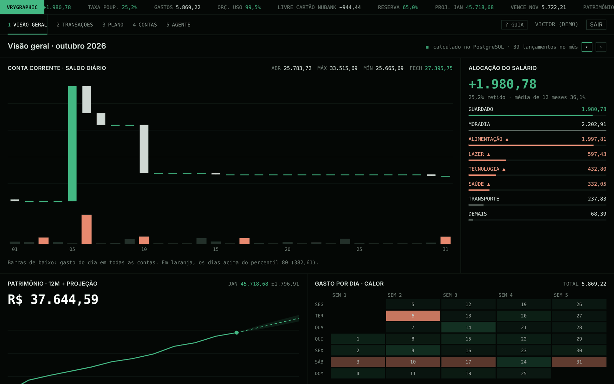

</div>

> A conta de demonstração já vem com 12 meses de lançamentos gerados de forma realista.

## Resumo para quem avalia

| O que costuma ser avaliado | Onde está neste repositório |
|---|---|
| **CRUD de verdade**, com validação, checagem de dono e exclusão lógica com desfazer | `apps/api/src/modules/*` (contas, categorias, lançamentos, transferências, orçamentos, metas, contas fixas) |
| **SQL além do `SELECT *`**: window functions, `LAG`, `RANK`, `PERCENTILE_CONT`, `FILTER`, `generate_series` | [`dashboard/queries.ts`](apps/api/src/modules/dashboard/queries.ts) |
| **Autenticação bem feita**: access token JWT + refresh token rotativo em cookie httpOnly, com detecção de reuso | [`auth/service.ts`](apps/api/src/modules/auth/service.ts) |
| **Dinheiro tratado certo**: centavos inteiros de ponta a ponta, parcelas que fecham no centavo | [`packages/shared`](packages/shared/src) |
| **Jobs em segundo plano** idempotentes e seguros mesmo rodando duas vezes ao mesmo tempo | [`jobs/`](apps/api/src/jobs) |
| **Testes contra banco de verdade**, sem mocks | [`apps/api/test/integration`](apps/api/test/integration) · 124 testes |
| **IA com travas**: chamada de ferramentas e confirmação humana antes de gravar | [`agent/`](apps/api/src/modules/agent) |
| **Visão de produto**: guia de primeiro uso, estados vazios, celular, menos movimento para quem pede | [`apps/web/src`](apps/web/src) |
| **Entrega**: imagem Docker, CI com Postgres, blueprint do Render | [`Dockerfile`](Dockerfile) · [`ci.yml`](.github/workflows/ci.yml) · [`DEPLOY.md`](DEPLOY.md) |

## Recursos

### Barra de comando: escreva do jeito que você fala

`mercado 120,50 alimentação` → despesa de R$ 120,50 em Alimentação, hoje.
`notebook 2.400 tecnologia 10x` → 10 parcelas no cartão, cada uma na fatura certa.
`+freela 640,50 trabalho inter` → receita na conta com apelido "inter".

O **mesmo parser** roda no navegador (prévia ao digitar) e no servidor (quem grava), então os dois nunca discordam.

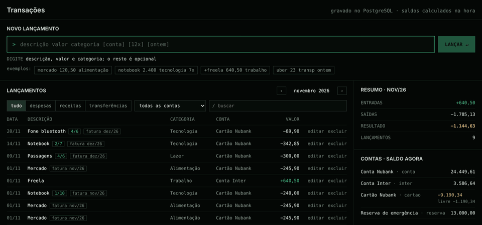

### Visão geral: painéis calculados em SQL

- **Saldo diário em candles**, com o gasto do dia em barras de volume (os 20% dias mais caros em destaque, com `PERCENTILE_CONT`).
- **Alocação do salário**: quanto foi guardado e para onde foi o resto, com as categorias que estouraram o orçamento marcadas.
- **Patrimônio de 12 meses + projeção** com faixa de ±1 desvio-padrão.
- **Mapa de calor** do gasto por dia da semana, **últimos lançamentos com o saldo** de cada conta (`SUM() OVER (PARTITION BY conta)`), **vencimentos** e **alertas**.
- Nos primeiros dias do mês, o gráfico de saldo mostra os últimos 30 dias, para nunca parecer vazio.

<details>
<summary>Visão geral completa</summary>

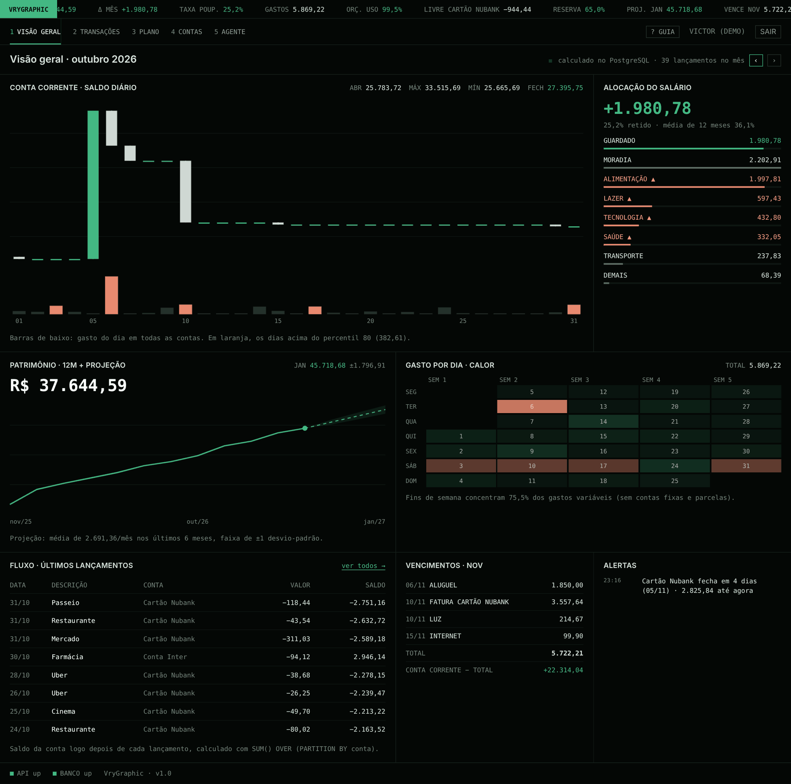
</details>

### Transações: o CRUD

Navegação por mês, filtros, busca, edição na própria linha (Enter salva, Esc cancela), exclusão com **desfazer**, transferências entre contas e paginação por cursor que não pula nem repete itens quando entram lançamentos novos.

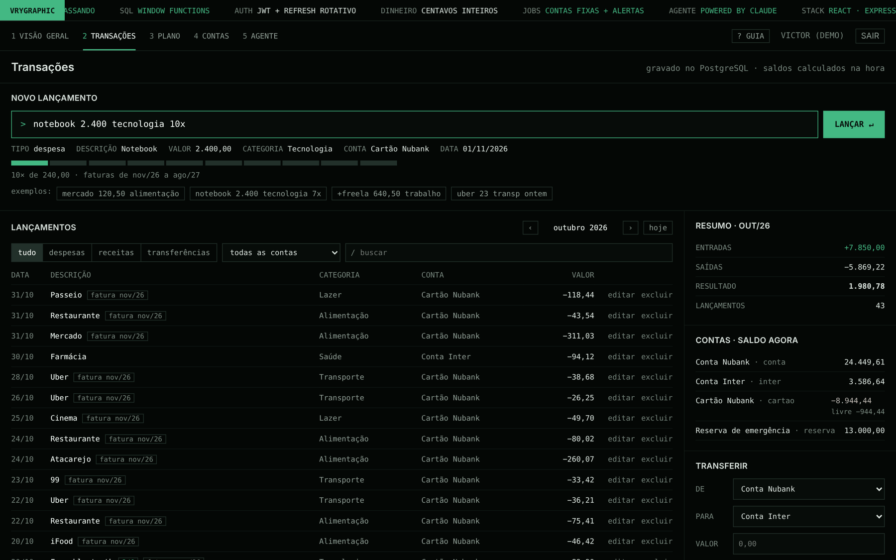

### Plano: orçamentos e metas

Orçado × gasto por categoria, sugestão de limite para o mês seguinte (média de 3 meses arredondada para cima em R$ 50, aplicada numa transação só) e um **simulador de metas**: mexa nos controles e veja quando a meta chega com juros compostos. As regras de alerta são configuráveis por pessoa.

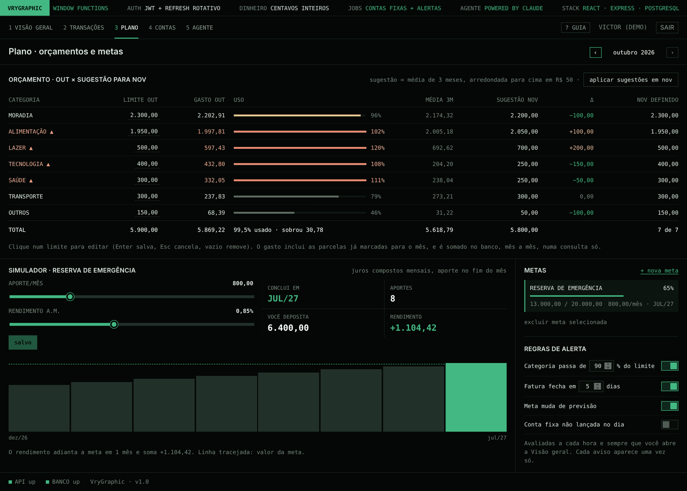

### Contas, categorias e contas fixas

Conta corrente, poupança, cartão (limite, fechamento e vencimento) e dinheiro. Os apelidos alimentam a barra de comando. Contas fixas (aluguel, assinaturas, salário) são lançadas sozinhas no dia por um job, que também recupera os meses atrasados se o servidor ficou parado.

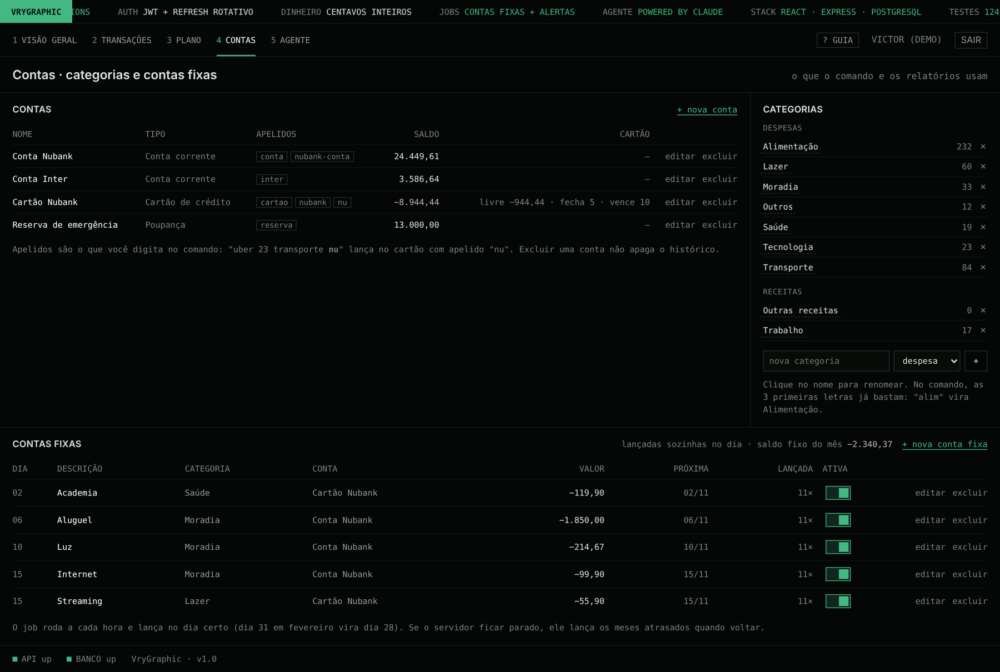

### Vry Agent: um assistente com IA que pergunta antes de gravar

Pergunte sobre o seu dinheiro ou peça para ele fazer algo. Roda na API do Claude com **11 ferramentas próprias**, que usam os mesmos serviços da API REST e só enxergam os dados de quem está logado. Leitura roda sozinha; **toda gravação para e pede `[s/n]`**, mostrando exatamente o que vai ser salvo. Sem acesso a arquivos, terminal ou internet.

| Perguntando | Confirmando uma gravação |
|---|---|
| 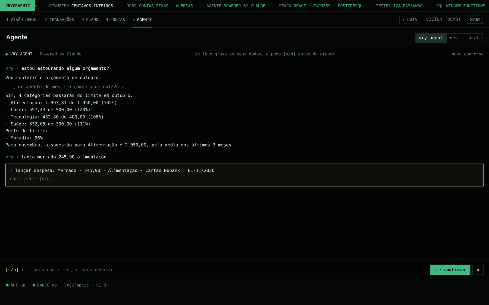 | 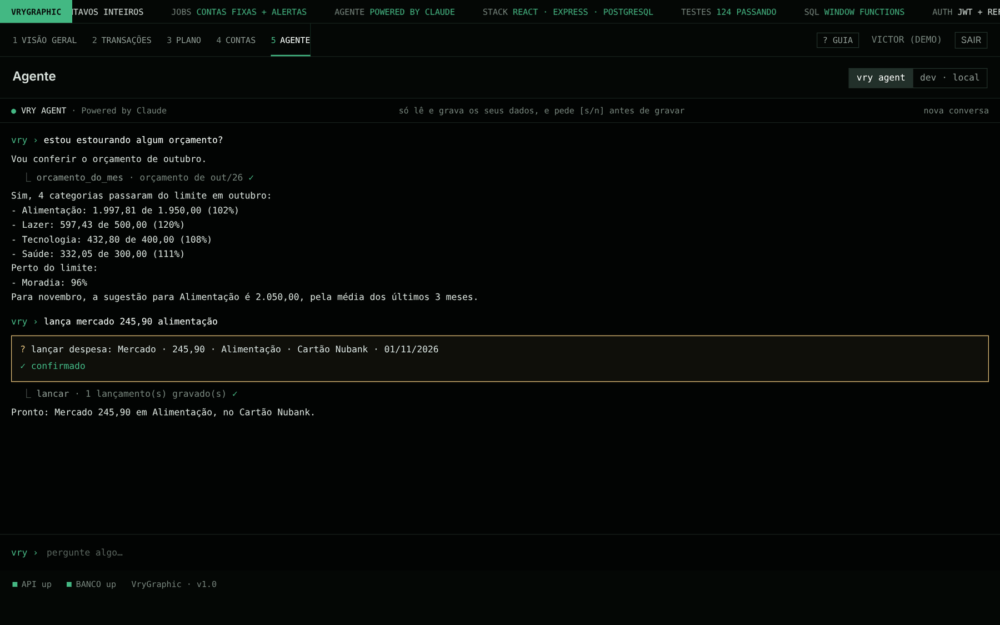 |

### Modo Dev: um terminal de verdade dentro do app

Rodando no seu PC, abre um terminal real (WebSocket + `node-pty` + xterm.js) na pasta do projeto para usar o Claude Code ou qualquer comando. Com travas: desligado por padrão, nunca em produção, só aceita a própria máquina, confere a origem e exige login.

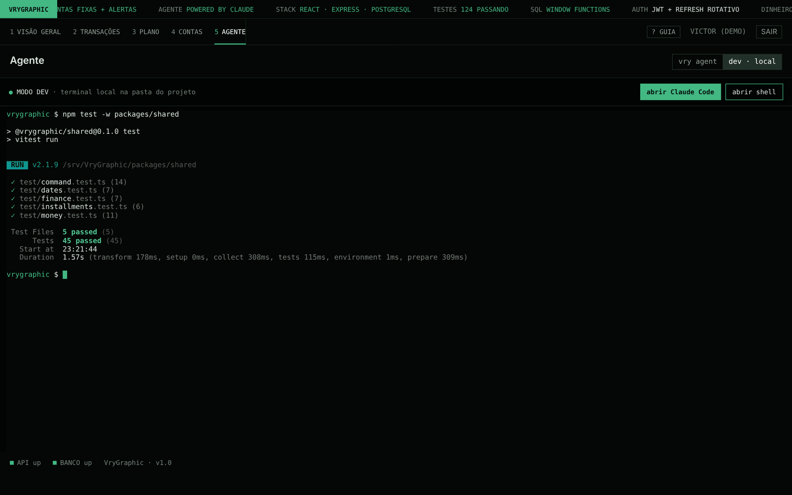

### Guia de primeiro uso e celular

Um guia de 23 passos destaca as partes reais da tela no primeiro acesso (dá para pular e rever). Todas as telas funcionam no celular.

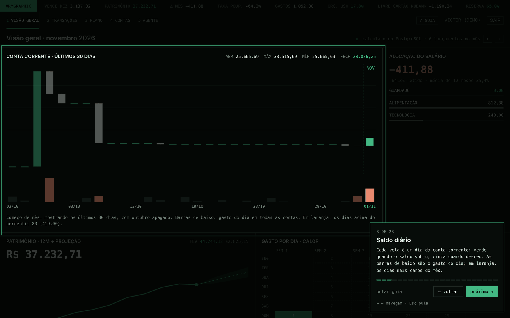

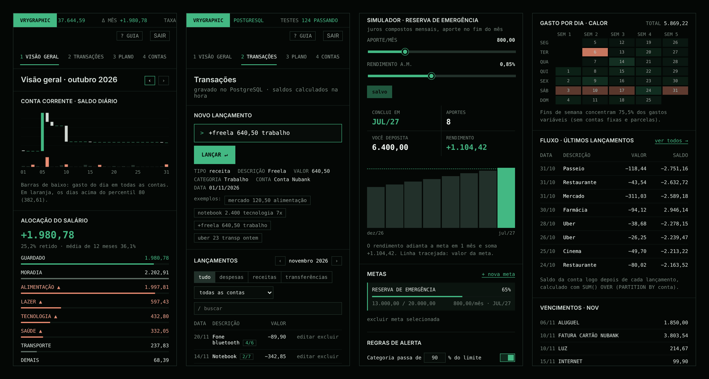

## Arquitetura

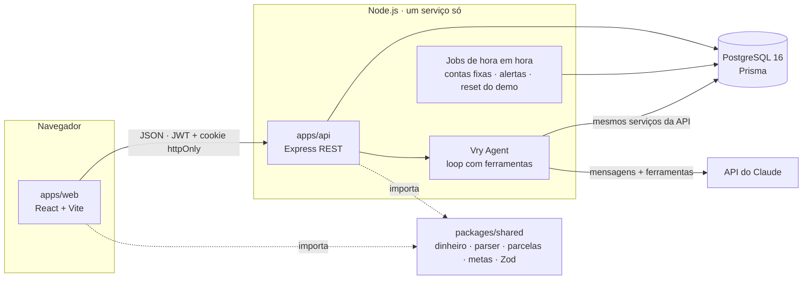

Em produção é **um container só**: o Express entrega o React compilado, as migrações rodam ao subir e o agendador roda no mesmo processo.

<details>
<summary>Modelo de dados</summary>

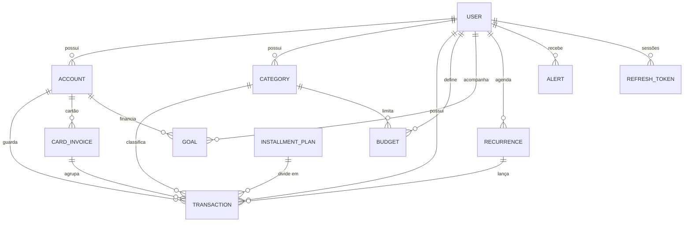
</details>

## Decisões técnicas

- **Centavos inteiros em todo lugar.** `BIGINT` no banco, inteiros no TypeScript, formatação só na tela. Nas parcelas o resto vai para a 1ª (R$ 2.400,00 em 7x = 342,90 + 6 × 342,85), então o total sempre fecha no centavo.
- **Saldo nunca é guardado.** Saldo = saldo inicial + `SUM(valor)`. Sem divergência, sem bug de sincronização. `CHECK constraints` fazem o próprio banco recusar uma despesa com valor positivo, mesmo se alguém burlar a API.
- **Conta pesada no SQL, não em loop de JavaScript.** Um pedido traz todos os painéis, montados com window functions:

  ```sql
  -- saldo diário: saldo inicial + tudo antes do mês + soma acumulada do mês
  SELECT d.day,
         (base.b + SUM(COALESCE(m.net, 0)) OVER w)::bigint AS close
  FROM days d CROSS JOIN base LEFT JOIN moves m ON m.day = d.day
  WINDOW w AS (ORDER BY d.day ROWS UNBOUNDED PRECEDING);
  ```

- **Fuso horário de propósito.** O banco guarda instantes (`timestamptz`); todo agrupamento por dia ou mês converte com `AT TIME ZONE 'America/Sao_Paulo'`. Uma data digitada é gravada ao meio-dia local, então nunca pula de dia.
- **Paginação por cursor** em `(occurred_at, created_at, id)` em vez de `OFFSET`: as páginas não pulam nem repetem enquanto entram lançamentos.
- **Refresh tokens** guardados só como hash SHA-256, girados a cada uso com um `UPDATE … WHERE revoked_at IS NULL` **atômico**. Reusar um token antigo derruba a família inteira (detecção de roubo); reuso em até 30 s conta como duas abas renovando juntas, não como ataque.
- **Jobs idempotentes.** Cada conta fixa "reserva" o mês com um `UPDATE` condicional antes de lançar, então duas execuções ao mesmo tempo não duplicam; os alertas usam uma `dedupe_key` única + `ON CONFLICT DO NOTHING`.
- **Um parser, dois ambientes.** A gramática do comando fica em `packages/shared` e é testada uma vez; o front usa na prévia e a API na gravação.
- **IA com uma pessoa no controle.** O agente só chama ferramentas da lista, as entradas são validadas com Zod, entrada errada volta para o modelo corrigir, gravação exige confirmação e há limite de mensagens por pessoa e por dia para proteger a conta da API.

### Bugs que encontrei e corrigi no caminho

- **Deslogava a cada F5 (só em dev).** O StrictMode do React restaurava a sessão duas vezes; duas renovações em paralelo pareciam roubo de token. Corrigido dos dois lados: uma renovação por vez no front, rotação atômica e uma pequena janela de tolerância no servidor. O teste que reproduziu o problema também mostrou que duas renovações exatamente simultâneas conseguiam passar.
- **10 pedidos por segundo com a tela parada.** Um callback criado a cada render nas dependências de um `useEffect` refazia a busca dos painéis sem parar. Achei contando os pedidos com Playwright; hoje são 0 pedidos com qualquer aba parada.
- **O dia 1º do mês parecia quebrado.** Parcelas marcadas para mais adiante no mês contavam como já gastas. A Visão geral agora mostra só o que já aconteceu; o Plano continua mostrando o comprometido.

## Testes

| Suíte | O que cobre | Quantidade |
|---|---|---|
| `packages/shared` | dinheiro, parser do comando, parcelas e faturas, metas com juros compostos, projeção, datas | 45 |
| `apps/api` integração | todas as rotas contra **PostgreSQL de verdade**: autenticação e rotação de token, CRUD e dono dos dados, números dos painéis conferidos à mão, jobs (atrasos e concorrência), alertas sem duplicar, agente com modelo simulado, terminal do Modo Dev | 79 |

O CI roda tudo a cada push com um Postgres e também monta a imagem Docker de produção.

## Como rodar no Windows (passo a passo)

### 1. Instale uma vez
- **Node.js 22**: https://nodejs.org (versão LTS). Confira no terminal: `node -v`
- **Docker Desktop**: https://www.docker.com/products/docker-desktop. Deixe ele **aberto** enquanto usa o projeto.

### 2. Abra o terminal na pasta do projeto
No VS Code: *Arquivo → Abrir pasta* e depois *Terminal → Novo terminal*.

### 3. Instale, prepare o banco e rode
```
npm install
npm run setup
npm run dev
```
O `setup` cria o `apps/api/.env`, sobe o Postgres no Docker, cria as tabelas e o usuário demo.

Abra **http://localhost:5173** e clique em **Entrar na demonstração**. No primeiro acesso abre o guia; o botão **? GUIA** mostra de novo.

### Já tinha o projeto rodando? Depois de atualizar
```
npm install
npm run db:deploy
npm run db:seed
```

### Comandos úteis

| Comando | O que faz |
|---|---|
| `npm run dev` | API (porta 3333) e site (porta 5173) juntos |
| `npm test` | Testes rápidos (regras compartilhadas + API sem banco) |
| `npm run test:db` | Testes de integração da API contra o Postgres (cria o banco `vrygraphic_test` sozinho) |
| `npm run db:up` / `db:down` | Liga / desliga o Postgres |
| `npm run db:seed` | Recria o usuário demo com 12 meses de dados |
| `docker compose --profile app up --build` | O container de produção em http://localhost:8080 |

Opcional: `ANTHROPIC_API_KEY=sua-chave` no `apps/api/.env` liga o agente (chave em platform.claude.com) e `DEV_TERMINAL=true` liga o Modo Dev. O deploy está em [DEPLOY.md](DEPLOY.md).

### Problemas comuns

- **`docker` não é reconhecido / banco não responde**: abra o Docker Desktop e espere aparecer *Engine running*.
- **Porta 5433 em uso**: outro Postgres está nessa porta. Troque `5433` no `docker-compose.yml` e no `apps/api/.env`.
- **Rodapé mostra `BANCO down`**: o Docker parou. Rode `npm run db:up`.

## API

Tudo em `/api/v1`, com `Authorization: Bearer <token>` (menos auth e health). Erros sempre como `{ error: { code, message, fields? } }`. Cada pessoa só enxerga os próprios dados: o id de outra pessoa responde 404, sem revelar que existe.

| Rota | O que faz |
|---|---|
| `POST /auth/register`, `/auth/login`, `/auth/refresh`, `/auth/logout` | Sessão com JWT + refresh token rotativo em cookie httpOnly |
| `GET/POST /accounts`, `PATCH/DELETE /accounts/:id` | Contas com saldo calculado |
| `GET/POST /categories`, `PATCH/DELETE /categories/:id` | Categorias de receita e despesa |
| `GET /transactions?month=&accountId=&kind=&q=&cursor=` | Lista paginada por cursor, com totais do filtro |
| `POST /transactions` · `POST /transactions/command` | Lançamento (com parcelas e faturas numa transação só) · pela barra de comando |
| `PATCH/DELETE /transactions/:id`, `POST /transactions/:id/restore` | Editar, excluir (lógico) e desfazer |
| `POST /transfers` | Transferência: duas pernas que somam zero |
| `GET/PUT /budgets`, `GET /budgets/plan`, `POST /budgets/apply` | Orçamento, planejamento com sugestão e aplicar vários limites |
| `GET/POST /goals`, `PATCH/DELETE /goals/:id` | Metas com projeção de juros compostos |
| `GET/POST /recurrences`, `PATCH/DELETE /recurrences/:id` | Contas fixas |
| `GET /dashboard?month=` | Todos os painéis da Visão geral num pedido |
| `GET /alerts`, `POST /alerts/read`, `GET/PUT /alerts/rules/:tipo` | Alertas e regras |
| `GET /agent/status`, `POST /agent/messages`, `POST /agent/sessions/:id/decision` | Vry Agent com confirmação [s/n] |
| `GET /me`, `PUT /me/onboarding` | Quem está logado e o guia de primeiro uso |

## Estrutura

```
packages/shared   regras puras usadas pelo front e pela API (dinheiro, parser, parcelas, metas, schemas Zod)
apps/api          Express + Prisma: autenticação, CRUD, SQL dos painéis, jobs, agente, terminal do Modo Dev
  prisma/         schema, migrações escritas à mão com CHECK constraints, seed do demo
  test/           testes de integração contra PostgreSQL
apps/web          React + Vite: visão geral, transações, plano, contas, agente, guia
docs/screenshots  imagens deste README
```

## Próximos passos

- [ ] Tela da fatura do cartão e "marcar como paga"
- [ ] Importar extrato CSV
- [ ] Configurações da conta (trocar senha, sair de todos os aparelhos, excluir conta)
- [ ] Testes ponta a ponta com Playwright no CI

## Autor

**Victor Augusto**, desenvolvedor full-stack (TypeScript, React, Node.js) em Salvador, aberto a vagas remotas.

[GitHub](https://github.com/VryDeveloper) · [LinkedIn](https://www.linkedin.com/in/victor-augusto-79a5612b6/)

Licença [MIT](LICENSE).
